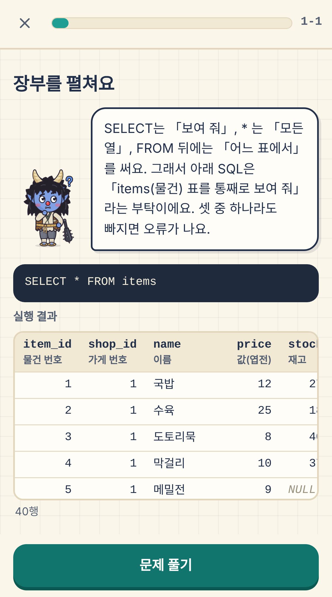
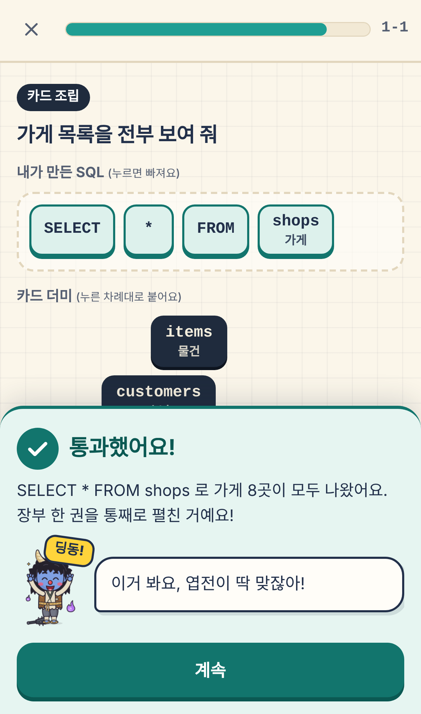
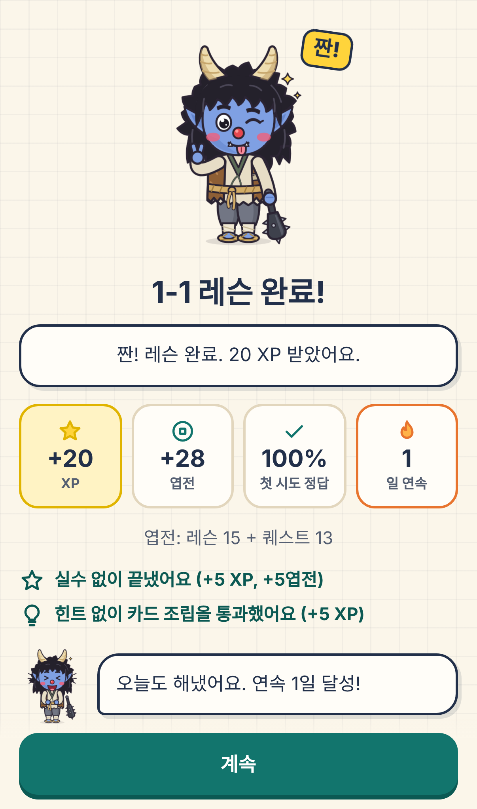
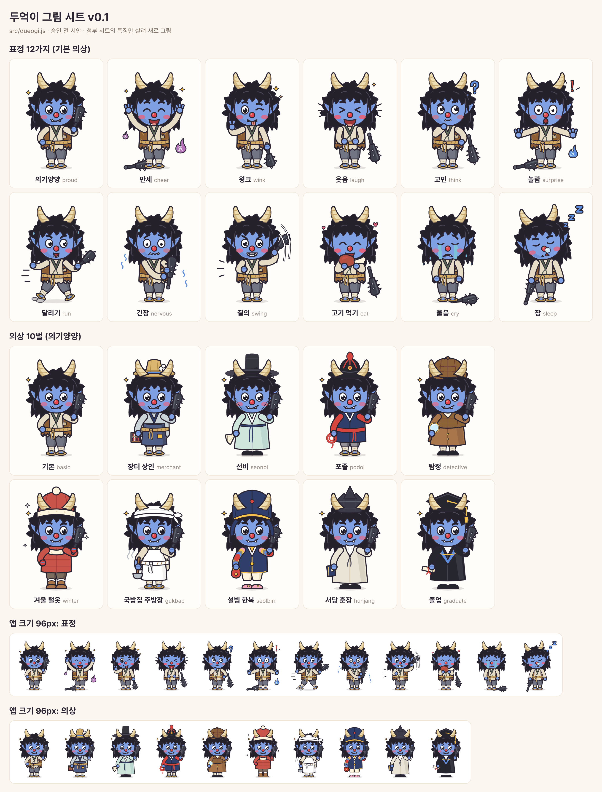

<!-- 이 파일은 tools/readme_gen.py가 data/ 표에서 자동으로 만든다. 손으로 고치지 말 것. -->
# 두억이와 SQL! v0.1.2

도깨비 장터의 장부 담당 **두억이**와 하루 5~10분, 휴대폰 브라우저에서 SQL을 「장터 장부 펼치기」부터 「장터 분석 실전」까지 익히는 듀오링고식 학습 웹앱이에요. **타자를 치지 않아요.** 모든 문제는 터치와 SQL 카드 조립으로 풀고, 조립한 SQL은 브라우저 안에서 실제로 실행해 결과 표를 정답 표와 비교해 채점해요.

**▶ [앱 바로 열기](https://fullcharge13.github.io/Learning-SQL/)** — 저장소 설정에서 GitHub Pages를 켜면 이 주소로 열려요. 아이폰은 사파리로 연 뒤 공유 → 「홈 화면에 추가」하면 앱처럼 쓰고 오프라인에서도 돼요.

> 이 저장소는 앱의 **소스 코드**예요. 공부는 위 링크의 앱에서 하고, 아래 「실행 방법」은 앱을 고치거나 다시 만들 때 써요.

<p align="center">  </p>

**배우는 것** — 1장 장터 장부 펼치기 · 2장 원하는 칸만 · 3장 조건으로 거르기 · 4장 여러 조건 · 5장 줄 세우기 · 6장 빈칸 다루기 · 7장 모아 세기 · 8장 묶어서 세기 · 9장 값 바꿔 보기 · 10장 표 잇기 ① · 11장 표 잇기 ② · 12장 질문 속 질문 · 13장 중간 표 만들기 · 14장 줄마다 순위 · 15장 누적과 이웃 줄 · 16장 날짜와 시계열 · 17장 장터 분석 실전

- 판: **v0.1.2** (게임 안 버전 표시, `LOG.md`의 판 번호와 같음)
- 내용: 17장 · 레슨 85개 · 심화 레슨 15개 · 문제 1300개(그중 카드 조립 178개) · 매일 도전 문제 틀 56개 · 일일 퀘스트 6종 · 배지 16개 · 두억이 의상 10벌 · 표정 12가지
- 서버 없음: SQL 실행은 브라우저 안의 **sql.js**(브라우저에서 돌아가는 SQLite) `1.15.2`이 화면 뒤 작업자(Web Worker)에서 맡고, 진도는 휴대폰 안(`localStorage`, 브라우저 저장 칸 `dueogi-sql-save`)에 저장돼요.
- 실행기는 `SELECT` 또는 `WITH`로 시작하는 문장 하나만 실행해요(조회 전용). 데이터를 바꾸는 SQL(`INSERT`·`UPDATE`·`DELETE`·`CREATE TABLE`)은 이 판에서 다루지 않아요.
- 이 앱은 듀오링고의 학습 방식(연속 기록, 짧은 레슨, 퀘스트)만 참고했고, 듀오링고의 이름·로고·캐릭터는 쓰지 않아요.

## 실행 방법

처음 한 번은 `npm install`로 개발 도구(esbuild 묶음 도구)와 SQL 실행기(sql.js)를 받아요.

| 하고 싶은 일 | 명령 | 설명 |
|---|---|---|
| 개발하면서 열어 보기 | `python3 tools/dev.py` | 코드를 묶어 `http://127.0.0.1:8765/dev/`로 열어 줘요 |
| 배포 파일 만들기 | `python3 build.py` | `dist/`에 `index.html`(앱과 레슨 목록) + `lessons/`(장마다 문제 파일) + `worker.js`(SQL 작업자) + `sql-wasm.wasm`(SQLite) + `manifest.webmanifest` + `sw.js` + `licenses.txt` + 아이콘. 이 폴더를 그대로 웹에 올리면 돼요 (첫 HTML 650KB 이하) |
| 장터 데이터 다시 만들기 | `node tools/gen_market.js` | `data/market.sql` (고정 씨앗이라 몇 번을 돌려도 같은 파일) |
| README 다시 만들기 | `python3 tools/readme_gen.py` | 데이터 표를 바꾼 뒤 실행. `--check`는 어긋남만 검사 |
| 두억이 그림 시트 다시 뽑기 | `python3 tools/dueogi_sheet.py` | `docs/img/dueogi-sheet.png` |
| README 첫머리 화면 캡처 바꾸기 | `python3 tests/flow.py` 뒤 `python3 tools/readme_shots.py` | `docs/img/screen-card.png`, `screen-build.png`, `screen-done.png` |

**시험 (확인 도구)**

| 명령 | 확인하는 것 |
|---|---|
| `npm test` | 규칙 단위 시험: 저장·옛 저장 옮기기·가져오기, 연속 기록 날짜 계산, XP·엽전, 퀘스트·배지·상점, 매일 도전, 채점(결과 표 비교), 장터 데이터 무늬, SQL 실행기, 대사, 그림 |
| `node tests/content.js --full 17` | 레슨 85개 전체 점검: 카드 조립 정답이 실행되고, 카드 하나를 빼거나 헷갈림 카드로 바꾸면 오답이 되는지, 카드 12장 이하, 결과 표가 실제 실행 결과와 같은지, 그 장까지 배운 낱말만 쓰는지, 힌트·요약 형식 |
| `python3 tests/engine_browser.py` | 실제 브라우저(Chromium) 안 sql.js 작업자: 시작, 실행, 3초 시간 초과 뒤 재시작, 오프라인 |
| `python3 tests/build_test.py` | 배포 파일: 크기 상한, 버전 표시, 장 파일, 서비스 작업자 저장본, 오프라인 열기, 라이선스 고지 |
| `python3 tests/flow.py` | 아이폰 17·17e·17 Pro Max·PC 크기 화면 순회: 넘침·콘솔 오류·터치 크기·카드 조립으로 첫 레슨 끝까지·장 평가·옛 저장 |
| `node tests/sim/economy.js` | 가상 학습자 30일 × 12판 엽전 경제 시뮬레이션(중앙값 표). `--daily`는 매일 도전까지 하는 학습자 |
| `python3 -m pytest tests/py -q` | 이 README 생성기 |

시험 중 브라우저를 쓰는 것은 Playwright(브라우저를 자동으로 조작하는 도구)의 Chromium이에요. 사파리(WebKit)로는 시험하지 못해서, 실제 아이폰에서 확인할 목록을 `docs/device-checklist.md`에 따로 두었어요.

## 폴더 구조

```
  src/                      화면·규칙 코드, 두억이 그림(SVG), 소리, 채점, sql.js 작업자(worker.js)
  data/lessons/             1~17장 레슨 표 (ch1.js … ch17.js)
  data/                     개념·대사·퀘스트·배지·의상·오류 설명·SQL 낱말 표, 장터 데이터(market.sql)
  build.py                  배포 폴더(dist/) 만들기
  tools/                    개발 서버, 장터 데이터·README 생성, 그림 시트·아이콘 만들기
  tests/                    시험 도구 (unit, py, sim, 레슨 점검, 브라우저 시험)
  docs/specs/               설계서
  docs/plans/               계획서
  docs/img/                 README용 그림 (스크립트로 뽑음)
  docs/lore-sources.md      도깨비·두억시니 고증 출처
  docs/device-checklist.md  실제 아이폰에서 확인할 목록
  README.md LOG.md          설명서(자동 생성)와 개발 일지
```

게임 내용(레슨·퀘스트·배지·의상)은 모두 `data/` 표에 있어요. 표를 고치면 화면 코드는 그대로 두고 내용만 바뀌어요.

## 연습 데이터: 도깨비 장터

모든 레슨이 같은 데이터베이스 하나를 써요. 표·열 이름은 영어이고 화면에는 한글 뜻을 함께 보여 줘요. 값(손님 이름 등)은 한글이에요. 기간은 2026년 한 해이고, 가게·물건·손님 이름은 모두 이 앱을 위해 지어낸 것이에요.

| 표 (뜻) | 열 (뜻) | 행 |
|---|---|---|
| `shops` (가게) | `shop_id` 가게 번호, `name` 이름, `owner` 주인, `category` 종류, `opened_on` 연 날 | 8 |
| `items` (물건) | `item_id` 물건 번호, `shop_id` 가게 번호, `name` 이름, `price` 값(엽전), `stock` 재고 | 40 |
| `customers` (손님) | `customer_id` 손님 번호, `name` 이름, `kind` 종류, `age` 나이, `village` 사는 마을, `first_visit` 첫 방문일 | 60 |
| `orders` (주문) | `order_id` 주문 번호, `customer_id` 손님 번호, `ordered_on` 주문 날짜, `status` 상태 | 591 |
| `order_items` (주문 내역) | `order_id` 주문 번호, `item_id` 물건 번호, `qty` 수량 | 1241 |

분석할 거리를 일부러 심어 두었어요: 약재 가게는 여름(6~8월)에 주문 건수가 많고(매출 금액으로는 차이가 작아 레슨은 건수 비중으로 봐요), 3월에 처음 온 손님은 다시 오는 비율이 높고, 공방(방망이)은 주문 건수는 적지만 한 건 금액이 크고, 12월에 주문이 몰려요. 나이 모르는 손님·재고 칸이 빈 물건·주문 없는 손님·팔린 적 없는 물건도 있어요(NULL과 짝 없는 행 연습용).

## 레슨 85개 + 심화 15개

한 레슨: 학습 목표 → 두억이 설명 카드(SQL과 그 실행 결과 표) → 터치 문제(객관식·빈자리·순서) → 카드 조립 → 이해도 확인 → 틀린 문제 다시 풀기 → 완료 요약. 레슨은 차례로 열리고, 장마다 5번째 레슨이 장 평가예요.

**카드 조립**: SQL 카드(장이 올라갈수록 낱말 → 짧은 구절)를 눌러 문장을 만들고 「실행」하면 결과 표가 나와요. 「제출」하면 정답 SQL의 결과 표와 비교해요(열 이름 대소문자·실수 반올림·`NULL`을 맞춰 보고, `ORDER BY`가 있을 때만 순서를 봐요). 카드 더미는 12장 이하이고 헷갈림 카드가 섞여 있어요. 문제마다 「쓸 표 보기」로 표의 열 이름과 한글 뜻, 앞 5행을 볼 수 있어요. 결과 표가 50행을 넘으면 앞 50행만 그려요.

**심화**: 장 평가를 통과하면 그 장의 심화 레슨이 열리는 장치는 들어 있지만, 심화 레슨 내용은 다음 판에 넣어요.

**매일 도전**: 1장을 마치면 홈 맨 위에 「오늘의 도전」 카드가 생겨요. 하루 3문제 — 문제 틀 56개에서 값을 바꿔 만든 터치 2문제와 끝낸 레슨의 카드 조립 1문제(틀린 개념이 든 장·레슨을 더 자주). 끝낸 장에서만 나오고, 같은 날 다시 열면 같은 문제예요. 다 풀면 XP 15 · 엽전 10, 「도전 n일째」 연속 7일마다 엽전 +20.

### 1장. 장터 장부 펼치기

| 레슨 | 제목 | 학습 목표 | 카드 조립 문제 | 핵심 개념 | 문제 |
|---|---|---|---|---|---|
| 1-1 | 장부를 펼쳐요 | SELECT * FROM으로 표 하나를 통째로 볼 수 있다 | 가게 목록을 전부 보여 줘 | 표(장부) 읽기, SELECT * FROM | 객관식 7 · 빈자리 3 · 카드 조립 1 · 이해도 확인 1 |
| 1-2 | 행과 열 | 표의 행과 열을 구별해 읽을 수 있다 | 물건 장부를 통째로 보여 줘 | 행과 열, 표(장부) 읽기, SELECT * FROM | 객관식 9 · 빈자리 1 · 카드 조립 1 · 이해도 확인 1 |
| 1-3 | 낱말에는 차례가 있어요 | SELECT * FROM의 차례를 지켜 쓸 수 있다 | 가게 장부를 통째로 펼쳐 줘 | SELECT * FROM, 표(장부) 읽기 | 객관식 7 · 빈자리 2 · 순서 1 · 카드 조립 1 · 이해도 확인 1 |
| 1-4 | 장터의 다섯 장부 | 장터의 다섯 표가 무엇을 적는지 안다 | 장부 다섯 권 중 물건 장부를 골라 통째로 보여 줘 | 장터의 다섯 표, 행과 열, 표(장부) 읽기 | 객관식 9 · 빈자리 2 · 카드 조립 1 · 이해도 확인 1 |
| 1-5 | 1장 평가 **(장 평가)** | 표·행·열을 읽고 SELECT * FROM을 쓸 수 있다 | 장터 가게 목록을 전부 보여 줘<br>물건 표를 골라 모든 열을 보여 줘 | 표(장부) 읽기, 행과 열, SELECT * FROM, 장터의 다섯 표 | 객관식 8 · 빈자리 2 · 순서 1 · 카드 조립 2 · 이해도 확인 1 |
| 1-A1 | 표 없이 값 보기 **(심화)** | FROM 없이 SELECT로 값 하나를 보여 줄 수 있다 | 물건 가짓수 40을 표 없이 그대로 보여 줘 | FROM 없이 값 보기 | 객관식 8 · 빈자리 2 · 순서 1 · 카드 조립 1 · 이해도 확인 1 |
| 1-A2 | SQL에 메모 달기 **(심화)** | -- 주석으로 SQL에 메모를 달 수 있다 | 「가게 장부」라는 메모를 달아서 가게 장부를 통째로 펼쳐 줘 | 주석 달기(--) | 객관식 8 · 빈자리 2 · 순서 1 · 카드 조립 1 · 이해도 확인 1 |
| 1-A3 | 다섯 장부 탐험 **(심화)** | 단서 둘로 같은 열 이름이 든 장부들 가운데 하나를 알아맞힐 수 있다 | 오영감 님 마지막 쪽지: shop_id 열이 있고 40행인 장부를 펼쳐 줘 | 다섯 장부 탐험 | 객관식 9 · 빈자리 1 · 카드 조립 1 · 이해도 확인 1 |

### 2장. 원하는 칸만

| 레슨 | 제목 | 학습 목표 | 카드 조립 문제 | 핵심 개념 | 문제 |
|---|---|---|---|---|---|
| 2-1 | 열을 골라요 | SELECT 뒤에 열 이름을 써서 원하는 열만 볼 수 있다 | 물건 이름과 값만 보여 줘 | 열 골라 보기 | 객관식 7 · 빈자리 2 · 순서 1 · 카드 조립 1 · 이해도 확인 1 |
| 2-2 | 값으로 셈해요 | + - * / 로 계산한 열을 만들 수 있다 | 물건 이름 옆에, 값을 5엽전씩 깎은 값을 보여 줘 | 계산 열 | 객관식 7 · 빈자리 2 · 순서 1 · 카드 조립 1 · 이해도 확인 1 |
| 2-3 | AS로 이름표 붙이기 | AS로 결과 표의 열에 새 이름을 붙일 수 있다 | 값 두 배로 올린 가격표를 보여 줘. 새 값 열은 AS로 double_price라고 붙여 | AS로 열 이름 붙이기 | 객관식 7 · 빈자리 2 · 순서 1 · 카드 조립 1 · 이해도 확인 1 |
| 2-4 | 열끼리 셈해요 | 열과 열을 셈하고 나누기 결과를 바르게 읽을 수 있다 | 물건마다 이름과 값 × 재고를 보여 줘. 그 열은 AS로 stock_value라고 붙여 | 계산 열, 열 골라 보기 | 객관식 7 · 빈자리 2 · 순서 1 · 카드 조립 1 · 이해도 확인 1 |
| 2-5 | 2장 평가 **(장 평가)** | 열을 골라 셈하고 AS로 이름 붙일 수 있다 | 값 두 배로 올린 가격표를 보여 줘. 새 값 열은 AS로 double_price라고 붙여<br>가게 이름과 주인 이름만 보여 줘 | 열 골라 보기, 계산 열, AS로 열 이름 붙이기 | 객관식 8 · 빈자리 2 · 순서 1 · 카드 조립 2 · 이해도 확인 1 |
| 2-A1 | 셈 차례와 괄호 **(심화)** | 셈이 섞인 식의 차례를 알고 괄호로 먼저 할 셈을 묶을 수 있다 | 값에 포장비 2엽전을 더해 3개 묶음 값을 보여 줘. 그 열은 bundle_price라고 붙여 | 괄호로 계산 순서 | 객관식 8 · 빈자리 2 · 순서 1 · 카드 조립 1 · 이해도 확인 1 |
| 2-A2 | 나머지 % 로 짝홀 **(심화)** | % 로 나머지를 셈해 짝수·홀수와 끝자리를 알아볼 수 있다 | 물건마다 이름과, 값을 2로 나눈 나머지를 보여 줘. 그 열은 remainder라고 붙여 | % 나머지 | 객관식 8 · 빈자리 2 · 순서 1 · 카드 조립 1 · 이해도 확인 1 |
| 2-A3 | 할인 가격표 **(심화)** | 셈 차례를 생각해 할인 값을 바르게 셈한 가격표를 만들 수 있다 | 금순 님 의뢰: 물건 이름, 값, 10% 깎은 값을 보여 줘. 깎은 값은 sale_price로 붙여 | 할인 가격표 | 객관식 9 · 빈자리 1 · 순서 1 · 카드 조립 1 · 이해도 확인 1 |

### 3장. 조건으로 거르기

| 레슨 | 제목 | 학습 목표 | 카드 조립 문제 | 핵심 개념 | 문제 |
|---|---|---|---|---|---|
| 3-1 | WHERE로 거르기 | WHERE로 조건에 맞는 행만 골라 볼 수 있다 | 산삼 약방(가게 번호 3)의 물건만 보여 줘 | WHERE로 거르기 | 객관식 7 · 빈자리 2 · 순서 1 · 카드 조립 1 · 이해도 확인 1 |
| 3-2 | 크다, 작다 | &gt; &lt; &gt;= &lt;= 로 값을 견줘 행을 고를 수 있다 | 100엽전 넘는 물건의 이름과 값을 보여 줘 | 비교 연산 | 객관식 7 · 빈자리 2 · 순서 1 · 카드 조립 1 · 이해도 확인 1 |
| 3-3 | 글자 값으로 거르기 | 글자 값을 작은따옴표로 감싸 같은 값인 행을 고를 수 있다 | 약재 가게만 보여 줘 | 글자 값 비교 | 객관식 7 · 빈자리 2 · 순서 1 · 카드 조립 1 · 이해도 확인 1 |
| 3-4 | 같지 않다 | &lt;&gt; 와 != 로 그 값이 아닌 행을 고를 수 있다 | 먹거리 가게가 아닌 가게를 보여 줘 | 비교 연산 | 객관식 7 · 빈자리 2 · 순서 1 · 카드 조립 1 · 이해도 확인 1 |
| 3-5 | 3장 평가 **(장 평가)** | WHERE와 비교 기호로 원하는 행만 고를 수 있다 | 100엽전 넘는 물건의 이름과 값을 보여 줘<br>여우 손님의 이름과 사는 마을을 보여 줘 | WHERE로 거르기, 비교 연산, 글자 값 비교 | 객관식 9 · 빈자리 2 · 순서 1 · 카드 조립 2 · 이해도 확인 1 |
| 3-A1 | 열과 열 견주기 **(심화)** | 한 행 안의 두 열을 견줘 조건에 맞는 행을 고를 수 있다 | 재고 수가 값보다 작은 물건을 보여 줘 | 열끼리 비교 | 객관식 8 · 빈자리 2 · 순서 1 · 카드 조립 1 · 이해도 확인 1 |
| 3-A2 | 날짜·글자 견주기 **(심화)** | &lt; &gt; 로 날짜와 글자 값의 앞뒤를 견줘 행을 고를 수 있다 | 12월 1일부터 장터에 처음 온 손님을 보여 줘 | 글자·날짜 범위 비교 | 객관식 8 · 빈자리 2 · 순서 1 · 카드 조립 1 · 이해도 확인 1 |
| 3-A3 | 재고 점검표 **(심화)** | 조건과 계산 열로 모자란 재고를 셈한 점검표를 만들 수 있다 | 최보부 님 의뢰: 재고 10개 밑인 물건 이름과 모자란 수를 보여 줘. 그 열은 shortage로 붙여 | 재고 점검표 | 객관식 8 · 빈자리 1 · 순서 1 · 카드 조립 1 · 이해도 확인 1 |

### 4장. 여러 조건

| 레슨 | 제목 | 학습 목표 | 카드 조립 문제 | 핵심 개념 | 문제 |
|---|---|---|---|---|---|
| 4-1 | AND와 BETWEEN | AND로 두 조건을 함께 걸고, BETWEEN으로 범위를 고를 수 있다 | 값이 10엽전 이상 20엽전 이하인 물건을 보여 줘 | AND·OR로 조건 묶기, BETWEEN으로 범위 | 객관식 7 · 빈자리 2 · 순서 1 · 카드 조립 1 · 이해도 확인 1 |
| 4-2 | OR와 IN | OR로 하나라도 맞는 행을, IN으로 여러 값 중 하나를 고를 수 있다 | 13살부터 19살까지인 손님을 보여 줘 | AND·OR로 조건 묶기, IN으로 여러 값 고르기, BETWEEN으로 범위 | 객관식 8 · 빈자리 2 · 순서 1 · 카드 조립 1 · 이해도 확인 1 |
| 4-3 | LIKE로 글자 찾기 | LIKE와 %·_ 로 글자 무늬에 맞는 행을 찾을 수 있다 | 이름에 「방망이」가 든 물건을 보여 줘 | LIKE로 글자 찾기 | 객관식 8 · 빈자리 2 · 순서 1 · 카드 조립 1 · 이해도 확인 1 |
| 4-4 | NOT과 괄호 | NOT으로 조건을 뒤집고, 괄호로 AND·OR의 차례를 정할 수 있다 | 이름에 「방망이」가 들지 않은 물건을 보여 줘 | NOT으로 뒤집기, AND·OR로 조건 묶기 | 객관식 9 · 빈자리 1 · 순서 1 · 카드 조립 1 · 이해도 확인 1 |
| 4-5 | 4장 평가 **(장 평가)** | AND·OR·NOT·IN·BETWEEN·LIKE로 행을 고를 수 있다 | 이름에 「방망이」가 든 물건을 보여 줘<br>「방망이」 앞에 딱 한 글자만 붙은 이름의 물건을 보여 줘 | AND·OR로 조건 묶기, BETWEEN으로 범위, IN으로 여러 값 고르기, LIKE로 글자 찾기, NOT으로 뒤집기 | 객관식 10 · 빈자리 2 · 순서 1 · 카드 조립 2 · 이해도 확인 1 |
| 4-A1 | NOT과 괄호 위치 **(심화)** | NOT이 뒤집는 범위를 괄호로 정해 「둘 다 아님」을 고를 수 있다 | 약재 가게도 공방도 아닌 가게를 보여 줘 | NOT과 괄호 위치 | 객관식 9 · 빈자리 1 · 순서 1 · 카드 조립 1 · 이해도 확인 1 |
| 4-A2 | LIKE 무늬 섞기 **(심화)** | _ 와 % 를 섞은 무늬로 글자 수와 자리를 정해 찾을 수 있다 | 이름이 세 글자 이상인 물건을 보여 줘 | LIKE 무늬 섞기 | 객관식 8 · 빈자리 1 · 순서 1 · 카드 조립 1 · 이해도 확인 1 |
| 4-A3 | 손님 찾기 의뢰 **(심화)** | 단서를 AND로 하나씩 더하며 행 수로 확인해 손님을 찾을 수 있다 | 달래 할멈 의뢰: 여우고개에 살고 이름이 두 글자인 손님을 찾아 줘 | 손님 찾기 의뢰 | 객관식 8 · 빈자리 1 · 순서 1 · 카드 조립 1 · 이해도 확인 1 |

### 5장. 줄 세우기

| 레슨 | 제목 | 학습 목표 | 카드 조립 문제 | 핵심 개념 | 문제 |
|---|---|---|---|---|---|
| 5-1 | ORDER BY로 줄 세우기 | ORDER BY로 행 차례를 정하고, DESC로 큰 값부터 세울 수 있다 | 가게 목록을 이름 가나다 차례로 보여 줘 | ORDER BY로 줄 세우기 | 객관식 8 · 빈자리 2 · 순서 1 · 카드 조립 1 · 이해도 확인 1 |
| 5-2 | 동점과 둘째 기준 | 기준 값이 같은 행(동점)의 차례를 둘째 기준으로 정할 수 있다 | 물건을 비싼 것부터, 값이 같으면 번호 차례로 보여 줘 | ORDER BY로 줄 세우기 | 객관식 8 · 빈자리 1 · 순서 1 · 카드 조립 1 · 이해도 확인 1 |
| 5-3 | LIMIT으로 위에서 몇 개 | LIMIT으로 위에서 몇 행만, OFFSET으로 건너뛰고 고를 수 있다 | 가장 비싼 물건 5개를 보여 줘 | LIMIT·OFFSET | 객관식 8 · 빈자리 2 · 순서 1 · 카드 조립 1 · 이해도 확인 1 |
| 5-4 | DISTINCT로 겹침 없애기 | DISTINCT로 똑같은 행을 하나만 남길 수 있다 | 손님들이 사는 마을을 겹치지 않게 가나다 차례로 보여 줘 | DISTINCT로 겹침 없애기 | 객관식 8 · 빈자리 1 · 순서 1 · 카드 조립 1 · 이해도 확인 1 |
| 5-5 | 5장 평가 **(장 평가)** | ORDER BY·LIMIT·DISTINCT로 행을 세우고 고를 수 있다 | 가장 비싼 물건 5개를 보여 줘<br>물건을 싼 것부터, 값이 같으면 이름 가나다 차례로 보여 줘 | ORDER BY로 줄 세우기, LIMIT·OFFSET, DISTINCT로 겹침 없애기 | 객관식 10 · 빈자리 2 · 순서 1 · 카드 조립 2 · 이해도 확인 1 |
| 5-A1 | 계산한 값으로 세우기 **(심화)** | ORDER BY 뒤에 계산식·별칭을 써서 줄 세울 수 있다 | 방망이 대장간(7번) 물건을 재고 값어치가 큰 것부터 보여 줘 | 계산값·별칭으로 정렬 | 객관식 8 · 빈자리 1 · 순서 1 · 카드 조립 1 · 이해도 확인 1 |
| 5-A2 | OFFSET으로 쪽 나누기 **(심화)** | OFFSET을 셈해 n쪽을 보고, 쪽이 겹치지 않게 할 수 있다 | 물건을 비싼 것부터 한 쪽에 5개씩 볼 때, 2쪽을 보여 줘 | OFFSET 쪽 나누기 | 객관식 9 · 빈자리 1 · 순서 1 · 카드 조립 1 · 이해도 확인 1 |
| 5-A3 | 값으로 N번째 찾기 **(심화)** | N번째 값을 찾고 그 값의 물건을 모두 고를 수 있다 | 나무쇠 님 의뢰: 물건값 가운데 네 번째로 싼 값을 알려 줘 | 값으로 N번째 찾기 | 객관식 7 · 빈자리 1 · 순서 1 · 카드 조립 1 · 이해도 확인 1 |

### 6장. 빈칸 다루기

| 레슨 | 제목 | 학습 목표 | 카드 조립 문제 | 핵심 개념 | 문제 |
|---|---|---|---|---|---|
| 6-1 | 빈칸 NULL과 IS NULL | 빈칸(NULL)이 「모르는 값」임을 알고 IS NULL로 찾을 수 있다 | 나이 모르는 손님을 보여 줘<br>나이 모르는 손님 중 사람 손님만 보여 줘 | NULL(빈칸) 이해, IS NULL로 빈칸 찾기 | 객관식 8 · 빈자리 1 · 순서 1 · 카드 조립 2 · 이해도 확인 1 |
| 6-2 | = NULL은 왜 안 될까 | = NULL이 안 되는 까닭을 알고 IS NOT NULL을 쓸 수 있다 | 도깨비 국밥집(1번 가게) 물건 중 재고를 아는 것만 보여 줘<br>나이 모르는 손님이 사는 마을을 겹치지 않게 보여 줘 | IS NULL로 빈칸 찾기, NULL(빈칸) 이해 | 객관식 8 · 빈자리 1 · 순서 1 · 카드 조립 2 · 이해도 확인 1 |
| 6-3 | 빈칸이 섞인 셈과 비교 | 빈칸이 셈·비교·줄 세우기에서 어떻게 되는지 알 수 있다 | 재고가 5개 미만이거나 재고를 모르는 물건을 보여 줘<br>물건 이름과 재고에 10을 더한 수를 plus_ten이라는 이름으로 보여 줘 | NULL(빈칸) 이해 | 객관식 8 · 빈자리 1 · 순서 1 · 카드 조립 2 · 이해도 확인 1 |
| 6-4 | COALESCE로 채우기 | COALESCE로 빈칸 대신 보여 줄 값을 정할 수 있다 | 물건 이름과 재고를 보여 주되, 모르는 재고는 0으로 채워 줘<br>다 팔려서 재고가 0인 물건을 보여 줘 | COALESCE로 빈칸 채우기, NULL(빈칸) 이해 | 객관식 9 · 빈자리 1 · 순서 1 · 카드 조립 2 · 이해도 확인 1 |
| 6-5 | 6장 평가 **(장 평가)** | 빈칸(NULL)을 IS NULL로 찾고 COALESCE로 채울 수 있다 | 나이 모르는 손님의 이름과 종류를 보여 줘<br>구름 잡화점(5번 가게) 물건 중 재고를 아는 것의 이름만 보여 줘<br>뚝딱 공방(8번 가게) 물건 이름과 재고를, 모르는 재고는 0으로 채워 보여 줘 | NULL(빈칸) 이해, IS NULL로 빈칸 찾기, COALESCE로 빈칸 채우기 | 객관식 10 · 빈자리 1 · 순서 1 · 카드 조립 3 · 이해도 확인 1 |

### 7장. 모아 세기

| 레슨 | 제목 | 학습 목표 | 카드 조립 문제 | 핵심 개념 | 문제 |
|---|---|---|---|---|---|
| 7-1 | COUNT로 세기 | COUNT로 행 수를 세고, 빈칸은 세지 않는 것을 안다 | 완료된 주문이 몇 건인지 done_orders라는 이름으로 세어 줘<br>사람 손님 중 나이를 아는 손님 수를 known_age라는 이름으로 세어 줘 | COUNT로 세기 | 객관식 8 · 빈자리 1 · 순서 1 · 카드 조립 2 · 이해도 확인 1 |
| 7-2 | SUM과 AVG | SUM으로 더하고 AVG로 평균을 내며, 빈칸이 빠지는 것을 안다 | 장터 전체 매출의 첫걸음, 주문된 수량을 total_qty라는 이름으로 모두 더해 줘<br>사람 손님의 평균 나이를 avg_age라는 이름으로 보여 줘 | SUM·AVG 합과 평균 | 객관식 9 · 빈자리 1 · 순서 1 · 카드 조립 2 · 이해도 확인 1 |
| 7-3 | MIN과 MAX | MIN·MAX로 가장 작은 값과 가장 큰 값을 찾을 수 있다 | 가장 싼 물건 값과 가장 비싼 물건 값을 lowest, highest라는 이름으로 보여 줘<br>취소된 주문 중 가장 이른 주문 날짜를 first_cancel이라는 이름으로 보여 줘 | MIN·MAX | 객관식 7 · 빈자리 1 · 순서 1 · 카드 조립 2 · 이해도 확인 1 |
| 7-4 | 모아 세기의 규칙 | 모아 세기에 계산을 넣고, 쓸 수 없는 자리를 안다 | 주문을 취소한 적 있는 손님 수를 겹치지 않게 cancel_customers라는 이름으로 세어 줘<br>뚝딱 공방(8번 가게) 물건의 값 × 재고를 모두 더해 stock_value라는 이름으로 보여 줘 | COUNT로 세기, SUM·AVG 합과 평균, MIN·MAX | 객관식 8 · 빈자리 1 · 순서 1 · 카드 조립 2 · 이해도 확인 1 |
| 7-5 | 7장 평가 **(장 평가)** | COUNT·SUM·AVG·MIN·MAX로 표를 모아 셀 수 있다 | 장터 전체 매출의 첫걸음, 주문된 수량을 total_qty라는 이름으로 모두 더해 줘<br>도깨비 손님 중 나이를 아는 손님 수를 known_age라는 이름으로 세어 줘<br>여우 손님 중 가장 나이 많은 손님의 나이를 oldest라는 이름으로 보여 줘 | COUNT로 세기, SUM·AVG 합과 평균, MIN·MAX | 객관식 9 · 빈자리 1 · 순서 1 · 카드 조립 3 · 이해도 확인 1 |

### 8장. 묶어서 세기

| 레슨 | 제목 | 학습 목표 | 카드 조립 문제 | 핵심 개념 | 문제 |
|---|---|---|---|---|---|
| 8-1 | GROUP BY로 묶기 | GROUP BY로 같은 값끼리 묶어 묶음마다 셀 수 있다 | 마을마다 손님이 몇 명인지 n이라는 이름으로 세어 줘<br>주문을 상태마다 몇 건인지 n이라는 이름으로 세어 줘 | GROUP BY로 묶기 | 객관식 7 · 빈자리 1 · 순서 1 · 카드 조립 2 · 이해도 확인 1 |
| 8-2 | 묶음마다 셈하기 | 묶음마다 SUM·AVG·MIN·MAX를 내고 SELECT 규칙을 안다 | 가게별 매출과 같은 모양으로, 오늘은 재고 값어치를 가게마다 stock_value라는 이름으로 보여 줘<br>손님 종류마다 평균 나이를 avg_age라는 이름으로 보여 줘 | GROUP BY로 묶기 | 객관식 7 · 빈자리 1 · 순서 1 · 카드 조립 2 · 이해도 확인 1 |
| 8-3 | 거르고 묶고 줄 세우기 | WHERE 뒤에 묶고, 빈칸 묶음과 묶음 줄 세우기를 안다 | 가게마다 물건 값의 합을 total이라는 이름으로 내서, 합이 큰 가게부터 보여 줘<br>나이 모르는 손님만 남겨 종류마다 몇 명인지 n이라는 이름으로 세어 줘 | GROUP BY로 묶기 | 객관식 8 · 빈자리 1 · 순서 1 · 카드 조립 2 · 이해도 확인 1 |
| 8-4 | HAVING으로 거르기 | HAVING으로 묶음을 거르고, WHERE와의 차이를 안다 | 재고 값어치(값 × 재고 합)가 1만 엽전 넘는 가게 번호를 보여 줘<br>100개 넘게 주문된 물건 번호를 보여 줘 | HAVING으로 묶음 거르기 | 객관식 7 · 빈자리 1 · 순서 1 · 카드 조립 2 · 이해도 확인 1 |
| 8-5 | 8장 평가 **(장 평가)** | GROUP BY로 묶어 세고 HAVING으로 묶음을 거를 수 있다 | 재고 값어치(값 × 재고 합)가 1만 엽전 넘는 가게 번호를 보여 줘<br>도깨비 손님이 4명 이상 사는 마을 이름을 보여 줘<br>나이 모르는 손님이 있는 손님 종류를 보여 줘 | GROUP BY로 묶기, HAVING으로 묶음 거르기 | 객관식 9 · 빈자리 1 · 순서 1 · 카드 조립 3 · 이해도 확인 1 |

### 9장. 값 바꿔 보기

| 레슨 | 제목 | 학습 목표 | 카드 조립 문제 | 핵심 개념 | 문제 |
|---|---|---|---|---|---|
| 9-1 | CASE WHEN으로 나누기 | CASE WHEN으로 조건에 따라 다른 값을 내고 ELSE·END를 안다 | 물건마다 이름과, 값이 100엽전 이상이면 '비싼' 아니면 '싼'을 band라는 이름으로 보여 줘<br>재고가 10개보다 적은 물건에만 '부족'을 stock_note라는 이름으로 붙여 줘 | CASE WHEN으로 나누기 | 객관식 7 · 빈자리 2 · 순서 1 · 카드 조립 2 · 이해도 확인 1 |
| 9-2 | 갈래 여럿과 차례 | WHEN을 여럿 쓰고, 위에서 처음 맞은 갈래가 고른다는 것을 안다 | 물건마다 이름과, 값으로 싼/보통/비싼을 나눠 price_band라는 이름으로 보여 줘<br>물건마다 재고가 빈칸이면 '모름', 10개 미만이면 '부족', 나머지는 '넉넉'을 stock_note로 보여 줘 | CASE WHEN으로 나누기 | 객관식 8 · 빈자리 1 · 순서 1 · 카드 조립 2 · 이해도 확인 1 |
| 9-3 | 글자 함수 | 글자 함수로 글자를 세고, 자르고, 바꾸고, 잇는다 | 이름이 다섯 자 이상인 물건의 이름을 보여 줘<br>물건마다 이름과, 값 뒤에 '엽전'을 이어 붙인 것을 price_tag라는 이름으로 보여 줘 | 글자 함수 | 객관식 8 · 빈자리 1 · 순서 1 · 카드 조립 2 · 이해도 확인 1 |
| 9-4 | 숫자 함수와 CAST | 정수 나눗셈을 CAST로 피하고 ROUND·ABS로 숫자를 다듬는다 | 손님 종류마다 평균 나이를 소수 첫째 자리까지 반올림해 avg_age라는 이름으로 보여 줘<br>물건마다 이름과, 값의 절반을 소수까지 half라는 이름으로 보여 줘 | 숫자 함수·CAST | 객관식 8 · 빈자리 1 · 순서 1 · 카드 조립 2 · 이해도 확인 1 |
| 9-5 | 9장 평가 **(장 평가)** | CASE로 값을 나누고 글자·숫자 함수로 값을 바꿀 수 있다 | 물건마다 이름과, 값으로 싼/보통/비싼을 나눠 price_band라는 이름으로 보여 줘<br>바람 보따리(6번 가게) 물건마다 이름과, 값이 100엽전에서 얼마나 먼지 gap이라는 이름으로 보여 줘<br>방망이 대장간(7번 가게) 물건마다 이름과, 이름의 앞 두 글자를 head라는 이름으로 보여 줘 | CASE WHEN으로 나누기, 글자 함수, 숫자 함수·CAST | 객관식 10 · 빈자리 1 · 순서 1 · 카드 조립 3 · 이해도 확인 1 |

### 10장. 표 잇기 ①

| 레슨 | 제목 | 학습 목표 | 카드 조립 문제 | 핵심 개념 | 문제 |
|---|---|---|---|---|---|
| 10-1 | JOIN으로 표 잇기 | JOIN … ON으로 두 표를 짝 맞춰 잇고 표.열로 열을 가리킨다 | 물건마다 이름과, 그 물건을 파는 가게의 주인을 보여 줘<br>공방 가게에서 파는 물건의 이름을 보여 줘 | INNER JOIN, ON으로 짝 맞추기 | 객관식 6 · 빈자리 2 · 순서 1 · 카드 조립 2 · 이해도 확인 1 |
| 10-2 | 표 별칭과 겹친 열 | 두 표에 다 있는 열을 가려 부르고, 표에 짧은 별칭을 붙인다 | 물건마다 이름과, 그 물건을 파는 가게 이름을 shop_name이라는 이름으로 보여 줘<br>주문 번호 10번까지의 주문에 손님 이름을 붙여 줘(주문 번호와 이름) | INNER JOIN, ON으로 짝 맞추기 | 객관식 6 · 빈자리 2 · 순서 1 · 카드 조립 2 · 이해도 확인 1 |
| 10-3 | 짝 없는 행, 빠진 ON | 짝 없는 행이 빠지는 INNER JOIN과 ON의 쓸모를 안다 | INNER JOIN으로, 팔린 적 있는 물건의 이름을 겹침 없이 보여 줘<br>1번 주문에 담긴 물건마다 이름과 수량을 보여 줘 | INNER JOIN, ON으로 짝 맞추기 | 객관식 8 · 빈자리 1 · 순서 1 · 카드 조립 2 · 이해도 확인 1 |
| 10-4 | 세 표 잇기와 매출 | JOIN을 두 번 이어 세 표로 완료 주문의 매출을 구한다 | 장터 전체 매출(완료 주문의 수량 × 값의 합)을 sales라는 이름으로 보여 줘<br>완료된 주문에서 팔린 물건 수량의 합을 total_qty라는 이름으로 보여 줘 | INNER JOIN, ON으로 짝 맞추기 | 객관식 8 · 순서 1 · 빈자리 1 · 카드 조립 2 · 이해도 확인 1 |
| 10-5 | 10장 평가 **(장 평가)** | JOIN … ON으로 표를 잇고 별칭으로 가려 매출까지 구할 수 있다 | 주문 번호 10번까지의 주문에 손님 이름을 붙여 줘(주문 번호와 이름)<br>3번 주문에 담긴 물건마다 이름과, 수량 × 값을 amount라는 이름으로 보여 줘<br>취소된 주문에 담겼던 물건의 수량 × 값 합을 sales라는 이름으로 보여 줘 | ON으로 짝 맞추기, INNER JOIN | 객관식 9 · 빈자리 1 · 순서 1 · 카드 조립 3 · 이해도 확인 1 |

### 11장. 표 잇기 ②

| 레슨 | 제목 | 학습 목표 | 카드 조립 문제 | 핵심 개념 | 문제 |
|---|---|---|---|---|---|
| 11-1 | LEFT JOIN으로 남기기 | LEFT JOIN으로 왼쪽 표의 행을 모두 남기고 빈칸을 읽는다 | 9월에 처음 온 손님의 이름과 주문 번호를 보여 줘. 주문 없는 손님도 빠짐없이<br>물건 표에 주문 내역 표를 LEFT JOIN으로 이은 행 수를 n이라는 이름으로 보여 줘 | LEFT JOIN | 객관식 8 · 빈자리 1 · 순서 1 · 카드 조립 2 · 이해도 확인 1 |
| 11-2 | 짝 없는 행 찾기 | LEFT JOIN 뒤 IS NULL로 짝 없는 행만 골라낸다 | 한 번도 주문하지 않은 손님의 이름을 보여 줘<br>한 번도 팔린 적 없는 물건의 이름을 보여 줘 | 짝 없는 행 찾기 | 객관식 7 · 빈자리 2 · 순서 1 · 카드 조립 2 · 이해도 확인 1 |
| 11-3 | 짝 없는 행 세기 | LEFT JOIN 뒤 짝 없는 행을 0으로 바르게 센다 | 물건마다 이름과 팔린 횟수(주문 내역 행 수)를 n이라는 이름으로, 안 팔린 물건은 0으로 보여 줘<br>팔린 횟수가 0인 물건의 이름을, 묶어 세는 방법으로 보여 줘 | LEFT JOIN, 짝 없는 행 찾기 | 객관식 6 · 빈자리 2 · 순서 1 · 카드 조립 2 · 이해도 확인 1 |
| 11-4 | 여러 표와 ON·WHERE | LEFT JOIN을 이어 여러 표를 잇고, 오른쪽 표 조건은 ON에 둔다 | 한 번도 안 팔린 물건이 있는 가게의 이름을 보여 줘<br>주문을 한 번도 취소한 적 없는 손님의 이름을 보여 줘 | 여러 표 잇기, LEFT JOIN | 객관식 7 · 빈자리 1 · 순서 1 · 카드 조립 2 · 이해도 확인 1 |
| 11-5 | 11장 평가 **(장 평가)** | LEFT JOIN으로 짝 없는 행을 남기고 찾고 바르게 셀 수 있다 | 한 번도 주문하지 않은 손님의 이름을 보여 줘<br>한 번도 안 팔린 물건을 파는 가게의 주인을 보여 줘<br>한 번에 3개씩 주문된 적이 없는 물건의 이름을 보여 줘 | LEFT JOIN, 짝 없는 행 찾기, 여러 표 잇기 | 객관식 10 · 빈자리 1 · 카드 조립 3 · 이해도 확인 1 |

### 12장. 질문 속 질문

| 레슨 | 제목 | 학습 목표 | 카드 조립 문제 | 핵심 개념 | 문제 |
|---|---|---|---|---|---|
| 12-1 | 값 하나 서브쿼리 | 괄호 안 SELECT로 값 하나를 구해 WHERE에서 견준다 | 평균보다 비싼 물건을 보여 줘<br>평균 나이보다 나이 많은 손님의 이름을 보여 줘 | 값 하나 서브쿼리 | 객관식 8 · 빈자리 1 · 순서 1 · 카드 조립 2 · 이해도 확인 1 |
| 12-2 | N번째로 비싼 것 | MAX 서브쿼리로 가장·두 번째 값을 찾고 같은 값을 다룬다 | 가장 비싼 물건의 이름을 보여 줘<br>두 번째로 비싼 값을 second_price라는 이름으로 보여 줘 | 값 하나 서브쿼리 | 객관식 7 · 빈자리 1 · 순서 1 · 카드 조립 2 · 이해도 확인 1 |
| 12-3 | IN으로 목록 받기 | IN (SELECT …)로 다른 표에서 고른 목록과 견주고 중복을 찾는다 | 공방 가게에서 파는 물건의 이름을 보여 줘<br>값이 같은 물건이 또 있는 물건의 이름을 보여 줘 | IN (SELECT …) | 객관식 8 · 빈자리 1 · 순서 1 · 카드 조립 2 · 이해도 확인 1 |
| 12-4 | NOT IN과 EXISTS | NOT IN의 빈칸 함정을 알고 EXISTS로 짝이 있는지 묻는다 | 한 번도 주문하지 않은 손님의 이름을 NOT EXISTS로 보여 줘<br>사람 손님 누구와도 나이가 같지 않은 손님의 이름을 보여 줘. 나이 빈칸은 목록에서 빼고 | IN (SELECT …), EXISTS | 객관식 8 · 빈자리 1 · 순서 1 · 카드 조립 2 · 이해도 확인 1 |
| 12-5 | 12장 평가 **(장 평가)** | 서브쿼리로 값 하나·목록과 견주고 EXISTS로 짝을 묻는다 | 평균보다 비싼 물건을 보여 줘<br>주문을 취소한 적이 있는 손님의 이름을 보여 줘<br>한 번도 팔린 적 없는 물건의 이름을 NOT EXISTS로 보여 줘 | 값 하나 서브쿼리, IN (SELECT …), EXISTS | 객관식 10 · 빈자리 1 · 카드 조립 3 · 이해도 확인 1 |

### 13장. 중간 표 만들기

| 레슨 | 제목 | 학습 목표 | 카드 조립 문제 | 핵심 개념 | 문제 |
|---|---|---|---|---|---|
| 13-1 | WITH로 중간 표 | WITH로 결과에 이름을 붙여 중간 표로 두고 다시 고른다 | 가게별 물건 값 합계로 다시 순위를 매겨 위 3곳을 보여 줘<br>손님이 9명 이상인 마을을 WITH로 보여 줘 | WITH로 중간 표 | 객관식 7 · 빈자리 1 · 순서 1 · 카드 조립 2 · 이해도 확인 1 |
| 13-2 | FROM 안 서브쿼리 | FROM 뒤 괄호 안 SELECT를 표처럼 쓰고 별칭을 붙인다 | 손님 한 명당 주문 수의 평균을 avg_n으로 보여 줘<br>가게별 물건 값 합계로 다시 순위를 매겨 위 3곳을 FROM 안 서브쿼리로 보여 줘 | FROM 안 서브쿼리 | 객관식 8 · 빈자리 1 · 순서 1 · 카드 조립 2 · 이해도 확인 1 |
| 13-3 | 중간 표 잇기 | 중간 표를 다른 표와 잇고, 중간 표를 여럿 만든다 | 손님이 9명 이상인 마을에 사는 손님의 이름과 마을을 보여 줘<br>손님이 가장 많은 마을의 손님 수를 max_n으로 보여 줘 | WITH로 중간 표 | 객관식 7 · 빈자리 1 · 순서 1 · 카드 조립 2 · 이해도 확인 1 |
| 13-4 | UNION으로 합치기 | UNION으로 두 SELECT의 행을 아래로 쌓고 겹침을 다룬다 | 손님 종류와 가게 종류를 겹침 없이 한 열로 모아 줘<br>가게 수와 물건 수를 label과 n 두 열로 한 표에 쌓아 줘 | UNION으로 합치기 | 객관식 8 · 빈자리 1 · 순서 1 · 카드 조립 2 · 이해도 확인 1 |
| 13-5 | 13장 평가 **(장 평가)** | WITH·FROM 안 서브쿼리로 중간 표를 만들고 UNION으로 쌓는다 | 가게별 물건 값 합계로 다시 순위를 매겨 위 3곳을 보여 줘<br>주문을 20번 이상 한 손님 수를 cnt로 보여 줘<br>가게 이름과 물건 이름을 한 열로 모아 줘 | WITH로 중간 표, FROM 안 서브쿼리, UNION으로 합치기 | 객관식 10 · 빈자리 1 · 카드 조립 3 · 이해도 확인 1 |

### 14장. 줄마다 순위

| 레슨 | 제목 | 학습 목표 | 카드 조립 문제 | 핵심 개념 | 문제 |
|---|---|---|---|---|---|
| 14-1 | 줄마다 번호 | ROW_NUMBER() OVER로 행을 그대로 둔 채 번호 열을 붙인다 | 산삼 약방(3번 가게) 물건에 싼 차례로 번호를 붙이되, 행은 물건 번호(item_id) 차례로 보여 줘<br>여우 손님에게 나이 많은 차례로 번호를 붙여 줘. 나이가 같으면 손님 번호가 작은 쪽이 먼저야 | ROW_NUMBER | 객관식 7 · 빈자리 1 · 순서 1 · 카드 조립 2 · 이해도 확인 1 |
| 14-2 | 같은 값, 같은 순위 | 동점일 때 세 순위 함수가 어떻게 다른지 안다 | 값이 6~8엽전인 물건에 싼 차례로 순위를 매겨 줘. 같은 값은 같은 순위, 다음 순위는 건너뛰어<br>57살 이상 도깨비 손님의 나이 순위를 빈 번호 없이 매겨 줘 | RANK·DENSE_RANK | 객관식 7 · 빈자리 1 · 순서 1 · 카드 조립 2 · 이해도 확인 1 |
| 14-3 | 가게마다 따로 순위 | PARTITION BY로 무리를 나눠 무리마다 1위부터 순위를 매긴다 | 가게마다 물건 값 순위를 비싼 차례로 매겨 줘<br>59살 이상 손님에게 손님 종류마다 나이 많은 차례로 순위를 매겨 줘 | PARTITION BY | 객관식 7 · 빈자리 1 · 순서 1 · 카드 조립 2 · 이해도 확인 1 |
| 14-4 | 그룹마다 1등 | 순위 표를 WITH로 먼저 만들고 바깥 WHERE로 1등만 고른다 | 가게마다 가장 비싼 물건을 보여 줘<br>손님 종류마다 가장 나이 많은 손님을 보여 줘. 나이가 같으면 모두 보여 줘 | PARTITION BY, RANK·DENSE_RANK | 객관식 7 · 빈자리 1 · 순서 1 · 카드 조립 2 · 이해도 확인 1 |
| 14-5 | 14장 평가 **(장 평가)** | 무리마다 순위를 매기고 동점과 1등을 다룬다 | 가게마다 가장 비싼 물건을 보여 줘<br>손님 종류마다 가장 나이 많은 손님을 한 명씩만 보여 줘. 나이가 같으면 손님 번호가 작은 쪽이야<br>값이 6~8엽전인 물건에 싼 차례로 순위를 매겨 줘. 같은 값은 같은 순위, 빈 번호는 없이 | ROW_NUMBER, RANK·DENSE_RANK, PARTITION BY | 객관식 8 · 빈자리 1 · 순서 1 · 카드 조립 3 · 이해도 확인 1 |

### 15장. 누적과 이웃 줄

| 레슨 | 제목 | 학습 목표 | 카드 조립 문제 | 핵심 개념 | 문제 |
|---|---|---|---|---|---|
| 15-1 | 차곡차곡 누적 합 | SUM() OVER (ORDER BY …)로 앞에서부터 쌓인 합을 붙인다 | 방망이 대장간(7번 가게) 물건을 비싼 것부터 하나씩 사 모으면 쌓이는 값을 보여 줘<br>값이 6~8엽전인 물건을 싼 것부터 하나씩 사 모은 값을 보여 줘. 값이 같아도 한 개씩 더해 | 누적 합 | 객관식 8 · 빈자리 1 · 순서 1 · 카드 조립 2 · 이해도 확인 1 |
| 15-2 | 손님별 누적 구매액 | PARTITION BY로 무리마다 따로 누적 합을 쌓는다 | 가게마다 싼 물건부터 하나씩 사 모은 값을 보여 줘<br>1·7번 가게 물건을 가게마다 비싼 것부터 하나씩 사 모은 값을 보여 줘 | 누적 합 | 객관식 7 · 빈자리 1 · 순서 1 · 카드 조립 2 · 이해도 확인 1 |
| 15-3 | 바로 앞 줄, 바로 뒤 줄 | LAG·LEAD로 앞 행·뒤 행의 값을 가져와 차이를 본다 | 8번 가게 물건을 싼 차례로 세우고, 바로 앞 물건보다 몇 엽전 비싼지 보여 줘<br>무쇠(7번 손님)의 주문마다 바로 앞 주문 날짜를 함께 보여 줘 | LAG·LEAD 이웃 줄 | 객관식 8 · 빈자리 1 · 순서 1 · 카드 조립 2 · 이해도 확인 1 |
| 15-4 | 움직이는 평균 | ROWS BETWEEN으로 창 틀을 정해 최근 몇 행의 평균을 낸다 | 여우 손님을 처음 온 차례로 세우고, 자기와 바로 앞 두 손님의 평균 나이를 소수 첫째 자리까지 보여 줘<br>여우 손님을 처음 온 차례로 세우고, 자기와 바로 앞·뒤 손님의 평균 나이를 소수 첫째 자리까지 보여 줘 | 이동 평균 | 객관식 8 · 빈자리 1 · 순서 1 · 카드 조립 2 · 이해도 확인 1 |
| 15-5 | 15장 평가 **(장 평가)** | 누적 합, 앞뒤 행, 이동 평균을 창 함수로 낸다 | 가게마다 싼 물건부터 하나씩 사 모은 값을 보여 줘<br>3번 가게 물건을 싼 차례로 세우고, 바로 뒤 물건이 몇 엽전 더 비싼지 보여 줘<br>7번 가게 물건을 싼 차례로 세우고, 자기와 바로 앞·뒤 물건의 평균 값을 소수 첫째 자리까지 보여 줘 | 누적 합, LAG·LEAD 이웃 줄, 이동 평균 | 객관식 10 · 빈자리 1 · 순서 1 · 카드 조립 3 · 이해도 확인 1 |

### 16장. 날짜와 시계열

| 레슨 | 제목 | 학습 목표 | 카드 조립 문제 | 핵심 개념 | 문제 |
|---|---|---|---|---|---|
| 16-1 | 날짜 셈하기 | date()로 며칠 뒤를 내고 JULIANDAY로 사이 날 수를 센다 | 무쇠(7번 손님)의 주문마다 7일 뒤 날짜를 보여 줘<br>가게마다 문을 연 날부터 연말(12월 31일)까지 며칠인지 보여 줘 | date·strftime | 객관식 7 · 빈자리 1 · 순서 1 · 카드 조립 2 · 이해도 확인 1 |
| 16-2 | 달마다 묶기 | strftime으로 날짜에서 달·요일을 뽑아 묶는다 | 주문을 달마다 묶어 몇 건인지 보여 줘<br>12월 주문만 요일마다 몇 건인지 보여 줘 | date·strftime, 월별로 묶기 | 객관식 7 · 빈자리 1 · 순서 1 · 카드 조립 2 · 이해도 확인 1 |
| 16-3 | 지난달 대비 증감 | LAG로 지난달 값을 붙이고 늘고 준 비율을 낸다 | 달마다 주문 수와, 지난달보다 몇 건 늘었는지 보여 줘<br>달마다 주문 수가 지난달보다 몇 % 늘었는지 소수 첫째 자리까지 보여 줘 | 지난달 대비 증감 | 객관식 8 · 빈자리 2 · 카드 조립 2 · 이해도 확인 1 |
| 16-4 | 다른 데이터베이스의 날짜 | MySQL·PostgreSQL의 날짜 함수를 이 장터 SQL과 짝 짓는다 | 한가람(6번 손님)의 주문마다 바로 앞 주문과 며칠 떨어졌는지 보여 줘<br>완료된 주문만 달마다 몇 건인지 보여 줘 | date·strftime, 월별로 묶기 | 객관식 8 · 빈자리 1 · 카드 조립 2 · 이해도 확인 1 |
| 16-5 | 16장 평가 **(장 평가)** | 날짜 셈, 달마다 묶기, 지난달 대비를 모두 써 본다 | 달마다 주문 수가 지난달보다 몇 % 늘었는지 소수 첫째 자리까지 보여 줘<br>무쇠(7번 손님)의 주문마다 바로 앞 주문과 며칠 떨어졌는지 보여 줘<br>달마다 주문 수를 많은 달부터 보여 줘. 수가 같으면 이른 달부터 | date·strftime, 월별로 묶기, 지난달 대비 증감 | 객관식 11 · 빈자리 1 · 카드 조립 3 · 이해도 확인 1 |

### 17장. 장터 분석 실전

| 레슨 | 제목 | 학습 목표 | 카드 조립 문제 | 핵심 개념 | 문제 |
|---|---|---|---|---|---|
| 17-1 | 첫 손님 무리(코호트) | 처음 온 달로 손님을 무리 짓고, 나중 달에 다시 왔는지 본다 | 처음 온 달마다 손님이 몇 명인지 보여 줘<br>1월에 처음 온 손님 중 2월부터 다시 주문한 손님을 보여 줘 | 코호트 재방문율 | 객관식 8 · 빈자리 1 · 순서 1 · 카드 조립 2 · 이해도 확인 1 |
| 17-2 | 다시 온 비율(재방문율) | 무리 크기와 다시 온 손님 수로 재방문율을 낸다 | 가게 8곳 중 120엽전 이상인 물건을 파는 가게가 몇 %인지 보여 줘<br>물건 40가지 중 한 번에 3개 이상 담긴 적 있는 물건이 몇 %인지 보여 줘 | 코호트 재방문율 | 객관식 7 · 빈자리 2 · 카드 조립 2 · 이해도 확인 1 |
| 17-3 | 함께 담긴 물건 찾기 | 주문 내역을 자기 자신과 이어 함께 담긴 물건 짝을 센다 | 10번 주문에 함께 담긴 물건 짝을 한 번씩 보여 줘<br>인삼차(12번)와 한 주문에 담긴 물건마다 몇 번 함께 담겼는지 보여 줘 | 함께 산 물건 | 객관식 9 · 빈자리 1 · 카드 조립 2 · 이해도 확인 1 |
| 17-4 | 숨은 무늬와 중앙값 | 비중으로 숨은 무늬를 찾고, 가운데 값(중앙값)을 낸다 | 가게마다 주문 내역이 몇 줄이고 한 줄 금액 평균이 얼마인지 보여 줘<br>여우 손님 나이의 중앙값을 보여 줘<br>주문 중 취소된 주문이 몇 %인지 소수 첫째 자리까지 보여 줘 | 종합 분석 | 객관식 9 · 빈자리 1 · 카드 조립 3 · 이해도 확인 1 |
| 17-5 | 17장 평가 **(장 평가)** | 재방문율, 함께 담긴 물건, 중앙값과 앞 장을 모두 써 본다 | 2월에 처음 온 손님 중 3월부터 다시 주문한 손님을 보여 줘<br>복주머니(28번)와 한 주문에 담긴 물건마다 몇 번 함께 담겼는지 보여 줘<br>먹거리 가게(1·2번) 물건 값의 중앙값을 보여 줘 | 코호트 재방문율, 함께 산 물건, 종합 분석, PARTITION BY, 지난달 대비 증감 | 객관식 10 · 빈자리 1 · 순서 1 · 카드 조립 3 · 이해도 확인 1 |

## 게임 장치

- **XP**(경험치): 레슨 첫 완료 10 (장 평가 30) + 실수 없음 5 + 힌트 없이 카드 조립 통과 5. 다시 하기는 10 (장 평가 15), 복습 한 판 10.
- **하루 목표와 연속 기록**: 하루 목표 10·20·30 XP(기본 20)를 채운 날마다 +1. 기록 보호권(200엽전, 최대 2개)이 빠진 날을 메워 줘요. 7·30·100일에 축하와 보상.
- **엽전**: 장터의 돈. 레슨 첫 완료 12 + 실수 없음 5, 퀘스트, 보물상자 10, 매일 도전, 연속 7일 50. 의상과 보호권을 사요.

### 일일 퀘스트 (6종 중 매일 3개)

날짜로 정해지는 뽑기라 같은 날에는 언제 열어도 같은 퀘스트가 나와요. 3개를 다 끝내면 보물상자(+10엽전).

| 퀘스트 | 목표 | 보상(엽전) |
|---|---|---|
| 레슨 2개 완료하기 | 2 | 5 |
| XP 20 얻기 | 20 | 5 |
| 힌트 없이 카드 조립 통과하기 | 1 | 8 |
| 오류가 난 조립을 고쳐서 통과하기 | 1 | 8 |
| 틀린 문제 3개 복습하기 (복습할 문제가 없는 날은 나오지 않음) | 3 | 5 |
| 실수 없이 레슨 끝내기 | 1 | 8 |

### 배지 16개

얻기 전에는 회색 실루엣과 조건 문구가 보여요.

| 배지 | 얻는 조건 |
|---|---|
| 첫 조회 | 첫 레슨(1-1)을 끝내요 |
| 장부 읽기 | 1~5장을 마치고 5장 평가를 통과해요 |
| 셈 도깨비 | 6~9장을 마치고 9장 평가를 통과해요 |
| 조인 장인 | 10~13장을 마치고 13장 평가를 통과해요 |
| 분석 도깨비 | 14~17장을 마치고 17장 평가를 통과해요 |
| 연속 7일 | 7일 연속으로 하루 목표를 채워요 |
| 연속 30일 | 30일 연속으로 하루 목표를 채워요 |
| 연속 100일 | 100일 연속으로 하루 목표를 채워요 |
| 오류 해결사 | 오류가 난 조립을 고쳐서 5번 통과해요 |
| 힌트 없이 10회 | 힌트 없이 카드 조립을 10번 통과해요 |
| 완벽주의자 | 실수 없는 레슨을 10번 끝내요 |
| 복습왕 | 복습 문제를 30개 풀어요 |
| 의상 수집가 | 기본 옷 말고 의상 3벌을 모아요 |
| 밤 공부 | 밤 10시부터 새벽 4시 사이에 레슨을 끝내요 |
| 심화 첫걸음 | 심화 레슨을 하나 끝내요 |
| 깊이 파는 사람 | 지금 있는 심화 레슨을 모두 끝내요 |

### 두억이 의상 10벌

| 의상 | 얻는 법 | 의상실 설명 |
|---|---|---|
| 기본 (베 저고리·털 조끼) | 처음부터 입고 있음 | 장터를 누비는 두억이 그대로! |
| 장터 상인 (앞치마·주판) | 110엽전 | 엽전 셈은 주판알처럼 착착! |
| 선비 (갓·도포) | 180엽전 | 장부도 글공부처럼 차근차근 |
| 포졸 (전립·쾌자) | 180엽전 | 장터 순찰, 빠진 행은 없나? |
| 탐정 | 180엽전 · 입으면 오류 설명이 탐정 말투로 바뀜 | 오류의 단서를 쫓아라! |
| 겨울 털옷 | 180엽전 | 추운 날에도 장부는 따끈하게 |
| 국밥집 주방장 | 240엽전 | 한 그릇씩 묶어서 세어 볼까? |
| 설빔 한복 | 240엽전 | 새해 첫 장터 나들이 차림 |
| 서당 훈장 | 300엽전 | 이제 내가 가르쳐 볼까? |
| 졸업 (학사모·가운) | 30일 연속 기록 보상 (판매 안 함) | 꾸준함이 졸업장을 만들어요! |

## 두억이

도깨비 장터의 장부를 맡은 꼬마 도깨비라는 설정의 **창작 캐릭터**예요. 친근한 해요체에 반말이 조금 섞인 말투를 쓰고, 틀려도 혼내지 않으며 오류는 「단서」라고 불러요. 이름은 민속의 「두억시니」에서 따왔지만 두억시니(사전에서는 「모질고 악한 귀신」)와 같은 존재라고 말하지 않아요.

그림은 이미지 파일 없이 코드(SVG)로 그려서, 의상 10벌 × 표정 12가지(의기양양 · 만세 · 윙크 · 웃음 · 고민 · 놀람 · 달리기 · 긴장 · 결의 · 고기 먹기 · 울음 · 잠)를 자유롭게 조합해요.

<p align="center"></p>

홈 화면 아이콘:

 

## 고증 출처

도깨비·두억시니에 관한 것은 사전에서 확인한 것만 쓰고, 확인하지 못한 설명(예: 메밀묵을 좋아한다)은 쓰지 않았어요. 자세한 표와 확인하지 못한 것은 `docs/lore-sources.md`에 있어요.

| 항목 | 사전 | 주소 | 확인한 날 |
|---|---|---|---|
| 두억시니 | 한국민족문화대백과사전 「잡귀(雜鬼)」 | https://encykorea.aks.ac.kr/Article/E0048201 | 2026-11-06 |
| 도깨비의 뜻 | 한국민족문화대백과사전 「도깨비」 | https://encykorea.aks.ac.kr/Article/E0015527 | 2026-11-06 |
| 도깨비 성격 | 한국민족문화대백과사전 「도깨비」 | https://encykorea.aks.ac.kr/Article/E0015527 | 2026-11-06 |
| 도깨비 생김새 | 한국민족문화대백과사전 「도깨비」 | https://encykorea.aks.ac.kr/Article/E0015527 | 2026-11-06 |
| 도깨비와 씨름 | 한국민족문화대백과사전 「도깨비」 | https://encykorea.aks.ac.kr/Article/E0015527 | 2026-11-06 |
| 도깨비불 | 한국민족문화대백과사전 「도깨비」 | https://encykorea.aks.ac.kr/Article/E0015527 | 2026-11-06 |
| 방망이·감투 | 한국민족문화대백과사전 「도깨비」 | https://encykorea.aks.ac.kr/Article/E0015527 | 2026-11-06 |
| 재물 | 한국민족문화대백과사전 「도깨비」 | https://encykorea.aks.ac.kr/Article/E0015527 | 2026-11-06 |
| 도깨비와 장터 | 한국민족문화대백과사전 「도깨비」 | https://encykorea.aks.ac.kr/Article/E0015527 | 2026-11-06 |
| 도깨비 설화 | 한국민족문화대백과사전 「도깨비 설화」 | https://encykorea.aks.ac.kr/Article/E0015531 | 2026-11-06 |

## 출처와 독창성

- **바탕 코드**: 같은 사용자의 「리아와 파이썬!」 v0.9 ([Fullcharge13/Learning-Python](https://github.com/Fullcharge13/Learning-Python))를 복사해 Python 실행기를 sql.js로, 리아 교수를 두억이로, 레슨을 SQL로 바꿨어요.
- **레슨 문장·문제·장터 데이터**는 모두 새로 썼어요. 아래 두 저장소는 **장 순서(주제 목차)와 문제 유형을 정하는 참고로만** 썼고, 문장·문제·데이터를 옮기지 않았어요.
  - `cybergeekgyan/SQL-for-Data-Scientists` — 주제 목차만 참고. 저장소 안의 교재 PDF는 무단 복제본으로 보여 **열지 않았어요**.
  - `krishnaik06/The-Grand-Complete-Data-Science-Materials` — MySQL 면접 문제의 **유형**(N번째로 비싼 것, 중복 찾기, 그룹마다 1등, 중앙값)만 참고. 이 저장소는 GPL-2 라이선스라 내용을 **복사하지 않았어요**.
- 쓰는 도구: sql.js 1.15.2 (MIT, Emscripten으로 만든 실행 코드 포함, 안의 SQLite는 퍼블릭 도메인), esbuild (MIT, 빌드 때만). 고지 전문은 배포 폴더의 `licenses.txt`(앱 설정에서 링크). 소리는 Web Audio로 합성해 음원 파일이 없어요.

## 알려진 한계

- 자동 시험은 Chromium에 아이폰 화면 설정을 입혀서 해요. 실제 아이폰 사파리(특히 오프라인에서 SQL 실행기 wasm 받기·홈 화면 앱)는 아직 확인하지 못했어요 → `docs/device-checklist.md`.
- SQL 실행기(`sql-wasm.wasm`, 약 670KB)는 처음 한 번 받아야 해요. 그 뒤로는 휴대폰에 저장돼 비행기 모드에서도 돼요. 받기 전에는 카드 조립 화면이 「실행기 준비 중이에요」를 보여 주고, 터치 문제는 계속 풀 수 있어요.
- 실행은 3초가 넘으면 멈춰요. 그 문제의 정답 SQL이 이 휴대폰에서 1초 넘게 걸리는 느린 기기면 10초까지 한 번 더 기다리고, 그래도 넘으면 「휴대폰이 좀 바빠서 오래 걸렸어요」로 끝내 제출 횟수에 세지 않아요(v0.1.1). 정답 시간은 1초를 넘으면 한 번 더 재서 작은 쪽으로 판정해요. 아주 느린 휴대폰은 한 번 약 25초(극단적으로는 30초 가까이) 기다릴 수 있고, 첫 3초가 지나면 바로 「조금 더 기다려 볼게요」를 보여 줘요. 빠른 기기에서 3초를 넘으면 지금처럼 「너무 오래 걸려서 멈췄어」(ON이 빠진 조인 등) 오답이에요. 실제 느린 휴대폰에서는 아직 확인하지 못했어요.
- 사파리는 홈 화면에 추가하지 않은 웹사이트의 저장을 7일 동안 방문이 없으면 지울 수 있어요. 홈 화면에 추가를 안내하고, 브라우저에 저장 보존을 요청하며(`navigator.storage.persist`), 설정에 저장 내보내기·가져오기를 두었어요.
- 같은 주소(`fullcharge13.github.io`)의 「리아와 파이썬!」과 저장·캐시 이름을 나눴어요(`dueogi-`). 두 앱의 진도는 따로예요.
- SQL 문법은 SQLite 기준이에요. 다른 데이터베이스(MySQL·PostgreSQL)와 다른 동작은 레슨에서 「이 장터에서는」이라고 밝히고, 16장에 비교 카드를 두었어요.
- 서버가 없어 정답도 앱 파일 안에 들어 있어요. 마음먹고 파일을 열어 보면 볼 수 있어요.
- 레슨 중간 진행은 24시간 동안만 이어서 할 수 있어요. 다른 휴대폰이나 브라우저로는 이어지지 않아요.
- PC에서도 열리지만 휴대폰 폭 그대로 가운데에 놓여요.

개발 과정과 결정 기록은 `LOG.md`, 설계는 `docs/specs/`, 작업 계획은 `docs/plans/`에 있어요.
